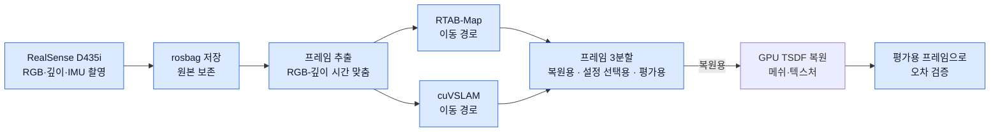
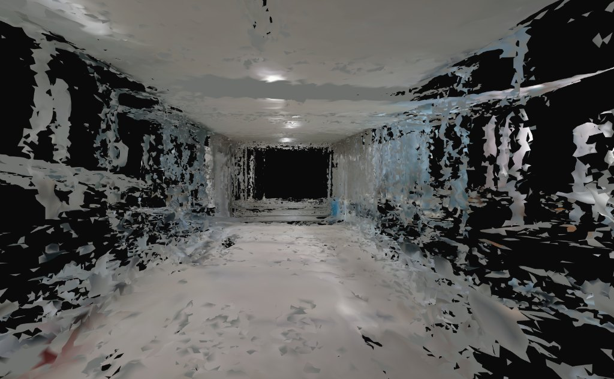
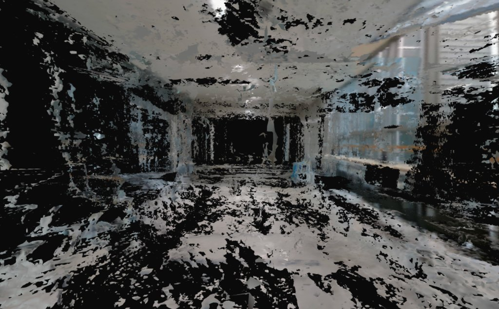

# Auto-Mobility

**RealSense 카메라로 촬영한 실내 공간을 3D 모델(Digital Twin)로 복원하고, 그 모델이 실제와 얼마나 다른지 센서 데이터로 직접 검증하는 Real-to-Sim 파이프라인**

[](./requirements.txt) [](./launch/) [](./src/auto_mobility/mesh/reconstruct_tsdf.py) [](./config/)

> [!NOTE]
> 2026 하계 온라인 현장실습(협력기관 ㈜퓨처드라이브, 2026.07.20 ~ 08.28, 6주) **팀 프로젝트**(3명)입니다.
> 공용 노트북 1대로 함께 작업했고, 저는 그중 **Visual SLAM 비교와 벤치마크 평가**를 맡아 전체 설계와 구현을 주도했습니다. 팀 저장소 [juhoimda/auto-mobility](https://github.com/juhoimda/auto-mobility)를 fork했습니다.

## 🧭 개요

자율주행·로봇 알고리즘을 시뮬레이터(NVIDIA Isaac Sim)에서 검증하려면 **실제 공간을 닮은 3D 환경**이 먼저 필요합니다. 고가의 라이다나 전용 스캐너 없이 RGB-D 카메라(RealSense D435i)만으로 이 환경을 만드는 것이 목표입니다.

이 프로젝트는 아래 과정을 하나의 파이프라인으로 연결합니다.

1. 카메라로 공간을 **촬영**합니다(RGB, 깊이, IMU).
2. **SLAM**으로 카메라가 어디를 어떻게 움직였는지(이동 경로)를 구합니다. 방식이 다른 두 가지(RTAB-Map, NVIDIA cuVSLAM)를 같은 조건에서 돌립니다.
3. 이동 경로와 깊이 데이터로 **3D 메쉬**를 만듭니다.
4. 복원에 쓰지 않고 따로 남겨 둔 프레임으로 메쉬의 **오차를 수치로 검증**합니다.

<details>
<summary>용어 풀이</summary>

- **SLAM**: 카메라 영상만으로 "내가 어디를 어떻게 움직였는지"를 구하는 기술
- **TSDF**: 여러 장의 깊이 사진을 겹쳐 하나의 3D 표면으로 합치는 방법
- **Digital Twin**: 실제 공간을 컴퓨터 안에 그대로 옮긴 3D 모델
- **프레임**: 촬영 영상의 한 장면(RGB 사진과 깊이 사진 한 쌍)

</details>

## 🙋 나의 역할

| 구분 | 영역 | 내용 |
| :---: | :--- | :--- |
| 🙋 **나** | 위치 추정·평가 | RTAB-Map·cuVSLAM 비교와 벤치마크 평가 (주 담당) |
| 🙋 **나** | 전체 설계 | 촬영부터 평가까지 파이프라인 구조, 실행 스크립트 |
| 🙋 **나** | 구현 주도 | 데이터 수집·프레임 추출, 프레임 분할, GPU 복원 연결 |
| 👥 강주호 | 3D 복원 | 이동 경로와 깊이 데이터로 메쉬 생성(TSDF 등) |
| 👥 손의진 | 환경·센서 | WSL2 ROS2·GPU 개발 환경, 센서 통신 최적화 |

팀원 모두 처음 접하는 분야라 함께 공부하며 개발했고, 노트북이 한 대뿐이라 작업을 같이 했습니다. 그래서 커밋은 제 계정이 많습니다(전체 251개 중 약 92%, 231개). 세부 내용은 맨 아래 근거 보기에 있습니다.

## 🏗️ 시스템 구성



각 단계의 결과는 이전 단계 데이터를 수정하지 않고 별도 산출물로 저장합니다(원본 rosbag, SLAM 결과, 이동 경로, 점군·메쉬, 평가 리포트). 같은 원본 데이터에 여러 알고리즘과 설정을 반복 적용하며 비교하기 위해서입니다.

## 🔧 핵심 설계 결정

각 결정을 **문제 → 분석(대안 비교) → 선택 → 결과** 순서로 정리했습니다.

### 🧭 1. SLAM을 두 방식으로 비교한 이유

- **문제:** SLAM 한 가지 결과만 믿기 어렵습니다. 같은 공간도 알고리즘과 환경에 따라 이동 경로가 달라집니다.
- **분석:** 비교해 보니 RTAB-Map은 루프 폐쇄(같은 곳으로 돌아왔을 때 경로 보정)와 지도 관리에 강하지만 계산량과 저장 용량이 커질 수 있었습니다. cuVSLAM은 특징점이 충분하면 정밀하고 GPU로 빠르지만, 무늬 없는 벽·저조도·흔들림에 민감해 추적이 끊길 수 있었습니다.
- **선택:** 둘을 같은 센서 데이터와 같은 프레임 기준으로 돌리고, 이동 경로를 같은 형식(TUM)으로 맞춰 비교합니다([백엔드 코드](./src/auto_mobility/reconstruction/pose/backends/)).
- ✅ **결과:** 두 방식의 결과는 비슷했고 특성이 달랐습니다. 성능이 낮은 카메라의 한계가 더 크게 작용해 뚜렷한 우열은 가리기 어려웠습니다(정량 비교 기록은 남아 있지 않습니다).

### 🧊 2. 메쉬 생성에 TSDF를 쓴 이유

- **문제:** 이동 경로와 깊이 데이터를 어떤 방식으로 3D 표면으로 바꿀지 정해야 했습니다.
- **분석:** 세 방식을 비교했습니다. TSDF는 여러 깊이 프레임을 겹쳐 센서 노이즈를 줄이고 관측한 형상을 비교적 충실히 보존하지만, 복셀을 작게 하면 메모리가 늘고 관측하지 못한 곳에 구멍이 생깁니다. Poisson은 매끄럽게 메우지만 세부 형상이 왜곡될 수 있고, BPA는 점이 고르지 않으면 구멍이 생기기 쉬웠습니다.
- **선택:** Open3D의 GPU TSDF를 사용하고, 구멍은 평가의 커버리지 지표로 확인합니다([코드](./src/auto_mobility/mesh/reconstruct_tsdf.py)).
- ✅ **결과:** 촬영한 프레임에서 점군(PLY)과 메쉬(OBJ)가 생성됩니다(아래 결과 참고).

### 🎯 3. 평가용 프레임을 복원에서 빼 둔 이유

- **문제:** 복원에 쓴 깊이로 같은 메쉬를 평가하면 오차가 당연히 작게 나옵니다.
- **분석:** 복원에 쓰지 않은 프레임으로만 평가해야 공정합니다. 다만 프레임을 빼면 내보내는 메쉬(OBJ)도 그 프레임을 못 쓴 모델이 됩니다.
- **선택:** 프레임을 복원용(약 76%), 설정 선택용(12%), 평가용(12%)으로 나누고([코드](./src/auto_mobility/reconstruction/data/split.py)), 평가용 메쉬는 그대로 두되 전체 프레임으로 다시 복원한 납품용 메쉬(`model_full.obj`)를 따로 만듭니다. 평가 프레임이 복원에 섞이면 막는 검사와 테스트를 두었습니다([테스트](./tests/unit/test_benchmark_fix.py)).
- ✅ **결과:** 평가는 공정하게 유지하고, 납품용 메쉬는 모든 프레임을 활용합니다.

### 💾 4. GPU 메모리 초과와 별도 프로세스

- **문제:** TSDF 융합이 장면 크기와 상관없이 50만 블록을 미리 잡아, 계산상 약 41GB가 필요했습니다.
- **분석:** 장면 크기와 무관한 고정값이 원인이었고, Open3D 메쉬 추출이 비정상 종료하면 전체 파이프라인이 같이 죽는 문제도 있었습니다.
- **선택:** 카메라 이동 경로의 범위로 필요한 블록 수를 계산하고 상한(기본 8GB)을 두었으며, 융합을 별도 프로세스로 실행해 본 파이프라인을 보호합니다([코드](./src/auto_mobility/reconstruction/fusion/isolated.py)).
- ✅ **결과:** 미리 잡는 메모리가 장면 크기에 맞춰지고 상한이 생겼습니다.

### 🔀 5. 촬영과 SLAM 연산을 나눈 이유

- **문제:** 카메라로 촬영하면서 SLAM과 점군 연산까지 실시간으로 돌리자, 한 노트북의 자원이 부족해 이동 경로가 틀어지고 추적을 놓쳤습니다(빠른 회전과 노이즈 구간).
- **분석:** 데이터 수집과 고부하 연산이 같은 시간에 몰린 것이 원인이었습니다.
- **선택:** 먼저 센서 데이터를 rosbag으로 기록한 뒤, 별도 환경에서 오프라인으로 SLAM을 돌립니다. TSDF 복원도 복셀 크기·절단 거리를 조정하고 이상치를 제거해 메쉬를 다듬었습니다.
- ✅ **결과:** 같은 원본 데이터로 알고리즘과 설정을 반복해 비교할 수 있게 되었고, 이동 경로 추정이 안정되었습니다(수치 기록 없음).

### 🖥️ 6. 개발 환경을 VMware에서 WSL2로 옮긴 이유 (팀 공동)

- **문제:** VMware 가상머신에서는 센서 프레임이 누락되고 렌더링이 지연되었으며, GPU를 쓸 수 없어 CUDA 기반 SLAM과 3D 연산이 불가능했습니다.
- **분석:** 가상머신의 USB·GPU 전달 제약이 원인이었습니다.
- **선택:** 개발 환경을 WSL2 Ubuntu로 옮기고 NVIDIA의 WSL GPU 드라이버를 설정했습니다.
- ✅ **결과:** 센서 토픽 수신 주기가 안정되었고 GPU 가속 연산이 가능해졌습니다.

## 📊 결과

같은 실내 복도를 촬영한 데이터로 만든 텍스처 메쉬입니다.

<table align="center">
<tr>
<th align="center">RTAB-Map + TSDF</th>
<th align="center">cuVSLAM + TSDF</th>
</tr>
<tr>
<td></td>
<td></td>
</tr>
</table>

두 결과 모두 벽과 바닥이 복원되지만, 관측하지 못한 부분(검은 구멍)이 남아 있습니다. 카메라의 시야각, 롤링 셔터, 낮은 해상도 같은 하드웨어 한계가 영향을 주었습니다.

복원한 메쉬는 복원에 쓰지 않은 프레임에서 **깊이를 다시 그려(레이캐스팅) 실제 센서 깊이와 픽셀 단위로 비교**합니다. 기준은 다음과 같습니다.

| 지표 | 의미 | 좋은 방향 |
| :--- | :--- | :---: |
| Depth MAE | 렌더링한 깊이와 실제 깊이의 평균 오차(mm) | 낮을수록 |
| Depth P95 | 오차가 큰 상위 5% 지점의 오차(mm) | 낮을수록 |
| Coverage | 실제로 관측한 영역을 메쉬가 빈틈없이 채운 비율(%) | 높을수록 |
| Free-Space correctness | 빈 공간에 가짜 벽·유령 메쉬가 없는 정도(%) | 높을수록 |
| Within-20mm Precision | 오차 2cm 이내로 맞은 픽셀 비율(%) | 높을수록 |
| 메쉬 결함 | 구조적으로 잘못된 면(비다양체 등) | 적을수록 |

판정 기준값은 [`evaluation.yaml`](./config/evaluation.yaml)에 있습니다.

## ⚠️ 한계

- 위 지표는 평가 코드로 구현되어 있지만, 실제 촬영 데이터로 잰 수치(mm, %)를 기록한 결과 파일은 저장소에 없습니다.
- 사용한 RealSense D435i는 시야각이 넓을수록 오차가 급격히 커지고, 롤링 셔터와 낮은 해상도가 메쉬 품질을 제한했습니다.
- 6주의 짧은 기간과 노트북 1대의 자원 안에서 메쉬 품질을 높이는 데 집중했습니다. 목표였던 Isaac Sim 연동과 주행 검증은 하지 못했고, 메쉬를 불러오는 스크립트만 포함되어 있습니다.
- 납품용 메쉬 생성과 블록 수 계산에는 전용 자동 테스트가 없습니다.
- `standard.py`와 `cli.py`는 매우 큰 파일이라 단계별로 더 작은 모듈로 나눌 여지가 있습니다.

## 🧱 기술 스택

| 분류 | 기술 |
| :--- | :--- |
| 센서·통신 | Intel RealSense D435i, ROS2 Humble, CycloneDDS/FastDDS |
| 위치 추정 | RTAB-Map, NVIDIA cuVSLAM |
| 3D 복원 | Open3D 0.19(GPU), OpenCV, NumPy |
| 언어·테스트 | Python, C++, pytest |

## 📂 프로젝트 구조

```text
src/auto_mobility/
├── reconstruction/   # 핵심: 복원 파이프라인
│   ├── pose/         #   SLAM 연결, 이동 경로 판정
│   ├── data/         #   프레임 3분할, 프레임 선별
│   ├── fusion/       #   GPU TSDF 융합, 격리 실행
│   ├── appearance/   #   텍스처 베이킹, 텍스처 규격 검사
│   ├── evaluation/   #   깊이 오차 평가, 후보 순위
│   └── runtime/      #   프로세스 감시, 메모리·온도 예산
├── dataset/          # rosbag에서 프레임 추출, RGB-깊이 정렬
├── slam/             # C++ 오프라인 SLAM
├── isaac/            # Isaac Sim 메쉬 불러오기 스크립트(연동 검증은 못 함)
└── mesh/ nodes/ ...  # 초기 메쉬 도구, ROS2 노드
scripts/pipeline/     # 촬영·비교·평가 실행 스크립트
```

## 🚀 시작하기

RealSense D435i, ROS2 Humble(Ubuntu/WSL), NVIDIA GPU가 필요합니다. 자세한 설치와 사용법은 [가이드](./docs/guide.md)를 참고하세요.

```bash
./scripts/pipeline/capture_safe.sh hallway --view                       # 촬영
./scripts/pipeline/compare.sh hallway --preview --compare-backends --run-slam   # 빠른 확인
./scripts/pipeline/compare.sh hallway --standard --compare-backends             # 정식 비교·평가
```

| 모드 | 용도 |
| :--- | :--- |
| Preview | 파이프라인 연결 확인(최대 약 800 프레임 샘플) |
| Standard | 설정 탐색과 품질 평가까지 포함한 정식 모드(오래 걸림) |
| Fast-Compare | Standard보다 빠른 비교(약 1,600~2,000 프레임) |

## 🤖 개발 과정에서의 AI 활용

AI 코딩 도구는 코드를 빠르게 써 주는 도구였고, **무엇을 만들고 어떻게 검증할지는 직접 정했습니다.**

| AI에 맡긴 일 | 직접 한 일 |
| :--- | :--- |
| ROS2·Open3D 코드와 실행 스크립트 작성 | 촬영부터 평가까지 파이프라인 구조 설계 |
| 반복 작업 스크립트화 | 평가용 프레임을 복원에서 빼 두는 평가 방식 정하기 |
| 라이브러리 사용법 확인 | 두 SLAM을 같은 조건에서 비교하는 구성, 결과 메쉬 확인 |

## 📚 참고

- 팀 저장소: [juhoimda/auto-mobility](https://github.com/juhoimda/auto-mobility)

<details>
<summary>근거 보기</summary>

- 기간과 커밋: 2026-07-27 ~ 2026-08-27, 전체 251커밋. 제 계정 231커밋(약 92%), 손의진 계정(itanstar) 약 19커밋, 원본 소유 계정(juhoimda) 1커밋.
- 팀 내 주 담당: 강주호는 3D 복원과 메쉬 생성, 손의진은 개발 환경·센서 통신 최적화, 저는 Visual SLAM과 벤치마크 평가였습니다. 실제로는 공용 노트북 1대로 함께 작업했습니다.
- 손의진 커밋: `launch/rtab_*.launch.py`의 RTAB-Map 오도메트리 설정(`odom_always_process_most_recent_frame` 해제), 메쉬 스크립트에서 USD 생성 제거, 수신 노드의 이미지 디코딩 실패 경고 로그.
- 3분할 기본값: `benchmark_ratio=0.12`, `tuning_ratio=0.12`, 나머지 약 76%가 복원용입니다.
- 41GB는 500,000블록 × 16³ × 20바이트(색상 포함)의 계산값입니다.
- 출력 파일: `model.obj`, `model.mtl`(텍스처 이미지는 `textures/`), `model_full.obj`, `geometry_quality.json`, `appearance_quality.json`, `frames.csv`.
- 테스트 함수 236개(`def test_`를 센 값, 통과 여부와 무관). `python -m pytest tests`로 실행합니다.
- 결과 이미지: 실제 촬영 데이터로 복원한 결과 화면입니다.

</details>
